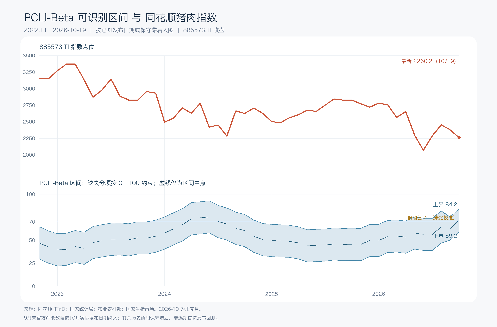

# PCLI-Beta 更新：2026-10-20

**判断：母猪去化信号明显增强，近端总存栏也转为同比下降，但生猪供给收缩仍未完整兑现。PCLI-Beta 可识别区间从 55.17—80.17 上移至 59.16—84.16；不能把区间中点 71.66 当成已确认的 ON。**

## 当日新增的官方数据

| 指标 | 2026-09 末 | 对比与变化 | 来源与首次可用时间 |
|---|---:|---|---|
| 能繁母猪存栏 | **3602 万头** | 比 2025-09 的 4035 万头下降 10.73%；比 2026-06 的 3780 万头下降 4.71%；比 2026-03 的 3904 万头下降 7.74% | [国家统计局 2026-10-20 10:00 解读](https://www.stats.gov.cn/sj/zxfbhjd/202610/t20261019_1965646.html)；同花顺 iFinD `S002841992` 同值 |
| 生猪存栏 | **42533 万头** | 比 2025-09 的 43680 万头下降 2.63%；比 2026-06 的 42491 万头微增 0.10% | [国家统计局 2026-10-19 发布](https://www.stats.gov.cn/sj/zxfbhjd/202610/t20261019_1965618.html)；同花顺 iFinD `S002841991` 同值 |

国家统计局同时公布：2026 年前三季度猪肉产量 **4508 万吨、同比增长 3.2%**，生猪出栏 **53739 万头、同比增长 1.4%**。这些累计数据不是 PCLI 四项里的月度得分输入，但足以限制“当前猪肉供应已经明显转紧”的判断。[国家统计局农业生产解读](https://www.stats.gov.cn/sj/zxfbhjd/202610/t20261019_1965646.html)

iFinD 本次回答已给出两项 9 月末新值，但指标描述里的“终止日期”仍停在 2026-06-30；因此新增值以国家统计局原文为核验依据，原始快照保留 iFinD 指标代码与官方来源，避免把接口元数据滞后误当成观察值尚未发布。

**时间口径：** 9 月末是观察期，10 月 19 日与 20 日是对应数据的首次官方公开日。本次仅让两项已查到实际发布日期的数据进入 2026-10-20 图点；更早的观察值仍按既有“观察月次月结束后可用”的保守代理规则处理。不能因此把整条历史曲线叫做逐期首次发布回测。

## 同一规则下的重算

| 模块 | 10 月 11 日快照 | 10 月 20 日快照 | 解释 |
|---|---:|---:|---|
| 母猪收缩，权重 45% | 93.18 | **100.00** | 同比 -10.73%、六个月 -7.74% 均超过 v0.1 的满分映射幅度，分数触顶；再加速去化不会继续抬高这一模块 |
| 生猪存栏子项 | 49.65 | **58.75** | 观察期从 6 月末更新到 9 月末，存栏同比由微增转为下降 |
| 屠宰子项 | 19.78 | **19.78** | 最新仍为 8 月 3755 万头，同比 +12.09%；iFinD 尚未返回 9 月值 |
| 近端有效供给合成，权重 20% | 34.72 | **39.26** | 存栏转弱抬分，但屠宰仍高，对供给收缩形成反证 |
| 均重修正，权重 10% | 63.02 | **63.02** | 仍采用 8 月国家生猪市场交易均重；不是全国出栏体重 |
| 仔猪管线，权重 25% | 缺失 | **缺失** | iFinD 未找到可连续复算的全国新生仔猪数量序列；仔猪价格不能替代数量 |
| **完整 PCLI 的可识别区间** | **55.17—80.17** | **59.16—84.16** | 上下界均提高 **3.98 分**；区间宽 25 分仍由仔猪模块缺失造成 |

计算方式、固定阈值与分项定义见[2026-10-11 复算说明](复算说明_20261011.md)和[复算脚本](rebuild_pcli.py)。本次没有重估权重或标准化参数。若仅作敏感性分析，未校准的旧阈值 70 要求仔猪模块达到 **43.38 分以上**；这不是一个已证实的仔猪分数，也不是交易触发。

## 与猪肉概念指数的对照

同花顺 iFinD 核对的 885573.TI 最近一个完整交易日 **2026-10-19 收盘为 2260.168 点**；10 月 9 日收盘为 2366.984 点，期间下跌 **4.51%**。这段走势发生在母猪官方新数公开之前，**不能解释为市场对 10 月 20 日数据的反应**。今天盘中行情不混入月度收盘走势图。

[2026-10-20 逐月计算表](outputs/2026-10-20/pcli_vs_885573_monthly.csv)保留子项得分、实际使用的观察月份和本次已核验的发布日期；[原始数据快照](data/raw/2026-10-20/)保留各指标的查询结果。旧快照及其结论保留，不覆盖。

## 研究判断与下一项验证

**远端产能收缩是事实，短期猪肉供给已经明显偏紧则不是。** 母猪降幅已足以推动模型母猪项触顶；但三季度末总存栏只比二季度末多 42 万头，8 月屠宰量仍两位数同比增长，前三季度猪肉产量仍增长。现在最关键的是验证 9—10 月新生仔猪数量、肥猪出栏公斤数和定点屠宰量是否连续转弱。缺少这些证据时，PCLI 区间跨越 70，不能给确定的 ON 标签。
